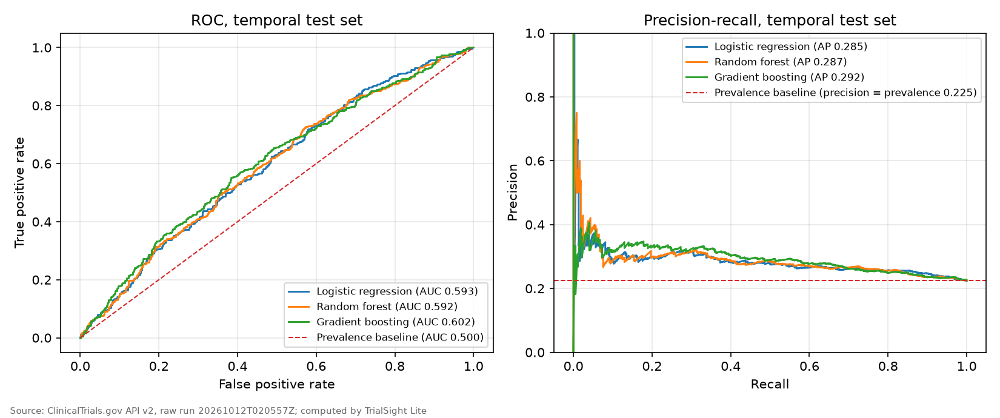
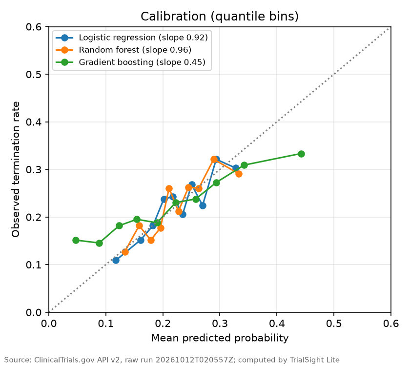
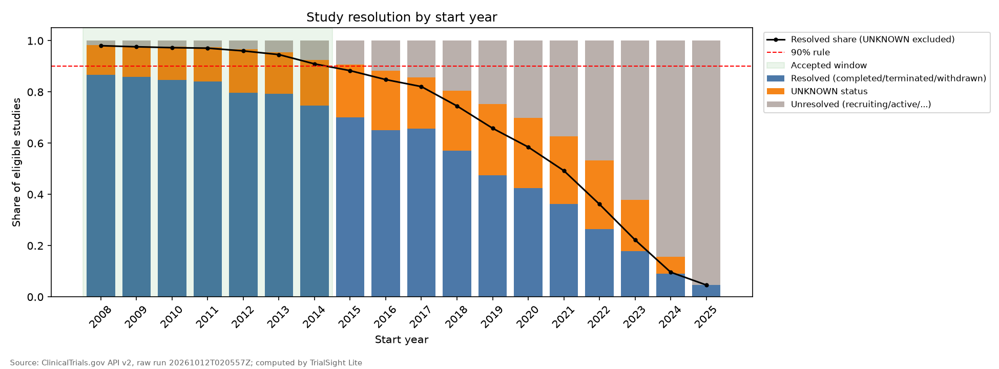

# TrialSight Lite

**Do registered design characteristics of Phase II/III oncology trials help distinguish trials that were later
completed from those that were terminated?** TrialSight Lite answers this retrospectively from public
[ClinicalTrials.gov](https://clinicaltrials.gov) API v2 registry metadata, with integrity-checked ingestion,
documented cohort construction, exploratory statistics, interpretable machine learning and a Streamlit app.

## Verified results

All numbers below come from the saved artifacts of one research run; `trialsight check-consistency` verifies
that the build, analysis, models and documentation refer to that same run.

| Stage | Result |
|---|---|
| Download (2026-10-12) | 35,637 records in 36 pages; 35,637 unique NCT IDs; API totalCount 35,637 at start and at end; no duplicates or pagination anomalies |
| Phase II, II/III, III | 28,961 (6,676 Phase I/II studies excluded by definition) |
| Oncology (MeSH Neoplasms) | 25,309 eligible, all statuses |
| Data-selected window | start years 2008-2014 (each year >= 90% resolved; see caveat below) |
| Classification cohort | **6,541** studies: 5,062 completed, 1,479 terminated (22.6%) |
| Temporal hold-out | train 4,893 (starts before 2013; 1,109 terminated); test **1,648** (2013-2014 starts; 370 terminated) |

Test-set performance (thresholds chosen on training data; 95% bootstrap CIs in `docs/EVALUATION_REPORT.md`):

| Model | ROC-AUC (95% CI) | PR-AUC | Brier | Calibration slope | Completed trials flagged |
|---|---|---|---|---|---|
| Prevalence baseline | 0.500 | 0.2245 | 0.1741 | n/a | n/a |
| Logistic regression | 0.593 (0.562-0.625) | 0.2853 | 0.1709 | 0.92 | 66.0% |
| Random forest | 0.592 (0.561-0.624) | 0.2873 | 0.1710 | 0.96 | 61.4% |
| LDA | 0.588 (0.557-0.621) | 0.2819 | 0.1717 | 0.68 | 64.8% |
| Gradient boosting | 0.602 (0.568-0.635) | 0.2918 | 0.1737 | 0.45 | 68.8% |

- All learned models beat the prevalence baseline (paired 95% CIs above zero), but modestly, and their
  intervals overlap. Gradient boosting's slightly higher ROC-AUC comes with poor calibration and no Brier
  improvement; logistic regression and random forest are the defensible reference models.
- At the chosen thresholds the models flag 61-69% of completed trials, about four trials per true termination.
- Exploratory statistics: 21 of 36 tests are significant after Benjamini-Hochberg correction, but the largest
  effect is |r| = 0.14 and the two strongest associations are time-varying fields (site and secondary-outcome
  counts) that may have been updated after the outcome.




## Key limitations

- **Retrospective, current-version records.** The API returns only the latest version of each record, so
  amended fields can reflect outcomes. Models measure retrospective association, not prospective accuracy.
- **Selection bias and UNKNOWN statuses.** The cohort conditions on reaching COMPLETED or TERMINATED. The
  2008-2014 window exists only because UNKNOWN-status studies (11.6-17.9% of each window year; 1,201 studies)
  are excluded from the 90% rule; counting them as unresolved, no year qualifies. If they had all ended, the
  in-window terminated share would lie between 19.1% and 34.6% (observed 22.6%). 2014 is borderline (Wilson
  lower bound 0.890).
- **`registration_lag_days`** is the most important feature for two models. Registration can happen after a
  study starts or ends, so it may leak post-start information; a targeted ablation tests this.
- **Definitions.** "Terminated" mixes safety, futility, accrual, business and early-success reasons. Oncology is
  MeSH `Neoplasms` (includes benign neoplasms); 2,417 records with cancer text but no MeSH annotation were
  excluded (all years).



Full details: [Methodology](docs/METHODOLOGY.md) · [Evaluation report](docs/EVALUATION_REPORT.md) ·
[Model card](docs/MODEL_CARD.md) · [Research findings](docs/RESEARCH_FINDINGS.md) ·
[Data dictionary](docs/DATA_DICTIONARY.md) · [Technical notes](docs/TECHNICAL_NOTES.md)

## Architecture

```
ClinicalTrials.gov API v2
  fetch        raw JSON pages (gzip) + manifest: query, UTC times, SHA-256, end-of-download recount
  verify       integrity recomputed from disk; critical failures can never be reconciled
  build        normalise -> data-quality rules -> cohort + data-selected window -> diagnostics
               staged; promoted to data/processed only if every critical check passes
  eda          chi-square/Fisher, Mann-Whitney, effect sizes, Wilson/bootstrap CIs, BH-FDR
  train        baselines, logistic, LDA, random forest, gradient boosting; temporal hold-out
  ablate       re-run the saved protocol without chosen features
  reproduce    reload saved models and recompute every metric
  publish-docs MODEL_CARD / EVALUATION_REPORT / RESEARCH_FINDINGS from artifacts only
  check-consistency  build, artifacts and docs refer to the same run; no nan; no local paths
  app          Streamlit + Plotly; shows only accepted research builds
```

| Module | Responsibility |
|---|---|
| `api_client.py`, `raw_store.py` | rate-limited API access, raw zone, verification, reconciliation |
| `flatten.py`, `quality.py` | normalised tables, data-quality rules DQ01-DQ16 |
| `cohort.py`, `diagnostics.py`, `report.py` | cohort, resolution-rule window, validation checks V01-V10 |
| `pipeline.py`, `storage.py`, `study_data.py` | orchestration, staging/quarantine, DuckDB + native Parquet, research guard |
| `feature_registry.py`, `features.py` | information-availability classes, leakage-checked feature sets |
| `analysis.py`, `modeling.py` | exploratory statistics; modelling, evaluation, ablation, reproduction |
| `docs_publish.py`, `consistency.py` | generated documentation; cross-artifact and publication checks |
| `app_data.py`, `app/streamlit_app.py` | application data loading and UI |

## Installation (Windows PowerShell, Python 3.11)

```powershell
git clone <your-repo-url>; cd trialsight-lite
py -3.11 -m venv .venv
.\.venv\Scripts\Activate.ps1
pip install -r requirements.txt          # pipeline + analysis (no PyArrow required)
pip install -e .
pytest -q
pip install -r requirements-app.txt      # optional Streamlit app (streamlit requires pyarrow)
pip install -e ".[docs]"                 # optional: matplotlib for README figures
```

## Reproduce the research

```powershell
trialsight -v inspect
trialsight -v fetch                      # exit 0 = verified download
trialsight -v build                      # exit 0 = accepted research build
trialsight eda
trialsight train
trialsight ablate --drop registration_lag_days
trialsight reproduce                     # exit 5 if any saved metric cannot be reproduced
trialsight publish-docs
python scripts/make_readme_figures.py
trialsight check-consistency             # exit 7 if anything refers to a different run
streamlit run app/streamlit_app.py
```

Exit codes: 0 ok; 1 input error or refused build; 2 API error; 3 download not research-grade; 4 cohort not
validated; 5 reproduction mismatch; 6 not an accepted research population; 7 inconsistent artifacts/docs.
A new download reflects the registry on that day, so counts will differ from the run reported here.
Raw data, processed databases and model files are not committed; they are regenerated by these commands.

## Data source and terms

Public registry data from ClinicalTrials.gov (US National Library of Medicine). No patient-level data is used,
and contact-person fields are not extracted. Review the ClinicalTrials.gov terms and conditions before reusing
the data.
